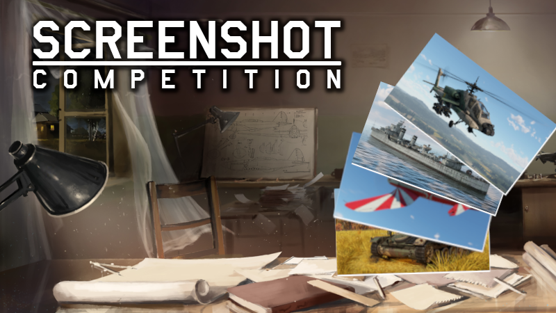

车长们，第250届《战争雷霆》Steam截图竞赛来了。这回官方把镜头直接对准刚上线的大版本“雄鹰之影（Eagles Shadow）”：新载具扎堆进场，两张地图做了视觉重制，再加上一战活动素材，够你把机库和战场拍成壁纸。最香的是，6个获奖名额各送300金鹰，投稿截止到11月20日。我把这届比赛的关键点和避坑细节都给你捋清。

## 🎯 核心看点速览

- **竞赛主题**：截图必须出现“雄鹰之影”大版本的新载具、两张视觉重制地图之一，或包含一战活动内容。
- **投稿方式**：在《战争雷霆》Steam社区中心发布截图，标题只写标签 **#WTscreen250**，不能夹带其他文字。
- **截止时间**：11月20日，别等到最后一天才翻回放。
- **奖励规模**：6名获奖者各得300金鹰，其中3名按社区评分选出，3名由官方评委选出。
- **参赛底线**：必须原创、必须是新截图，且只能提交游戏原始画面；不能用外部修图软件，也不能套Nvidia Ansel滤镜。游戏内滤镜、设置和回放功能可以放心用。
- **人气票限制**：同一作者靠社区投票夺冠，每四届截图竞赛限一次。

## 📌 重点深度解析

### 新版本就是本届的“官方取景地”

“雄鹰之影”这次带来的新载具是天然主角。你可以拍新车上路、空中编队、炮口焰特写，也可以把两张视觉重制后的地图当成背景板。官方明确给了三个选题方向：新载具、重制地点、一战活动。别把截图拍成普通对局记录，要让评委一眼看出“这是新版本的东西”。

### 规则比构图更先决定成败

这届比赛的硬规则不少：截图必须是你自己拍的，不能拿以前发过或参加过其他竞赛的旧图；不能上编辑软件，不能加Nvidia Ansel滤镜；标题只能保留 **#WTscreen250**，多写一句“求赞”都可能被判不合规。截图内容也要符合《战争雷霆》规则，别擦边。想加氛围，用游戏内置滤镜和设置；想找角度，用游戏回放功能慢慢调。

### 上期“A World of Blue”获奖作品回顾

第249届的主题是“A World of Blue”，社区投票和评委选出的作品都已经公布。想找灵感可以去Steam社区看看这些获奖截图，学习一下别人怎么用云层、海面和光影讲故事。

社区投票获奖作品：

- https://steamcommunity.com/sharedfiles/filedetails/?id=3835978831
- https://steamcommunity.com/sharedfiles/filedetails/?id=3837067886
- https://steamcommunity.com/sharedfiles/filedetails/?id=3836196107

官方评委获奖作品：

- https://steamcommunity.com/sharedfiles/filedetails/?id=3838326226
- https://steamcommunity.com/sharedfiles/filedetails/?id=3835143146
- https://steamcommunity.com/sharedfiles/filedetails/?id=3836076555

投稿入口：

- https://steamcommunity.com/sharedfiles/filedetails/?id=3439537726

## 💡 玩家实操与上手建议

- **先定素材再开机**：打开游戏前想清楚拍新载具还是重制地图。新载具建议选能体现版本辨识度的型号，重制地图则优先找标志性建筑、光照变化明显的位置。
- **用回放找最佳帧**：对局结束后进回放，暂停、切镜头、调时间，比在实战里手忙脚乱靠谱得多。
- **画质设置别乱堆**：游戏内滤镜和设置可用，但别为了“电影感”把画面调得连载具轮廓都看不清。评委要看的是《战争雷霆》，不是抽象艺术。
- **标题只留标签**：上传时标题填 **#WTscreen250**，不要加游戏名、不要写说明、不要加表情包。
- **避开旧图与外部滤镜**：旧图、PS、Nvidia Ansel滤镜都是雷区；一旦被查出，300金鹰就跟你没关系了。
- **奖励到账时间**：获奖奖励会在作者账户的14个工作日内发放，别刚公布就催客服。
- **想冲社区票**：构图之外，发布时间也有讲究。截稿前太晚提交，曝光时间不够；可以提前发布，再用合规方式在社区里互动。我的建议是先保证作品合规，再考虑拉票。

## 📢 官方 Telegram 频道推荐

想第一时间收到Steam限免、史低特惠和《战争雷霆》活动提醒，建议加入官方 Telegram 频道 **@steamhunterlink**。截图竞赛这种有截止日期的活动，最怕刷到消息时已经错过，频道推送能帮你把时间卡稳。

## ❓ 常见问题 FAQ

### Q1：截图里必须出现“雄鹰之影”的新载具吗？

不一定。新载具、两张视觉重制地图、一战活动内容，三者满足其一即可。但普通老地图配老载具的旧图，基本不符合本届主题。

### Q2：可以用PS、Lightroom或Nvidia Ansel滤镜修图吗？

不行。官方只接受游戏原始截图，外部编辑软件和Nvidia Ansel滤镜都不能用。游戏内置滤镜、设置和回放功能可以用。

### Q3：标题能写作品名吗？奖励多久到账？

标题只能写 **#WTscreen250**，不能包含其他文字。获奖奖励会在作者账户的14个工作日内发放，遇到结算高峰耐心等一等。
