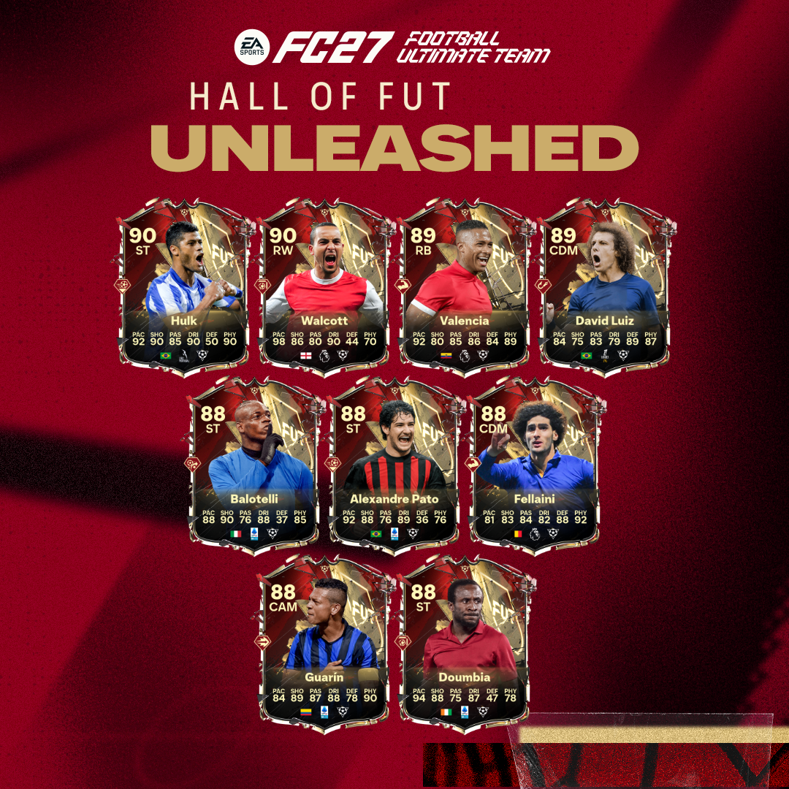
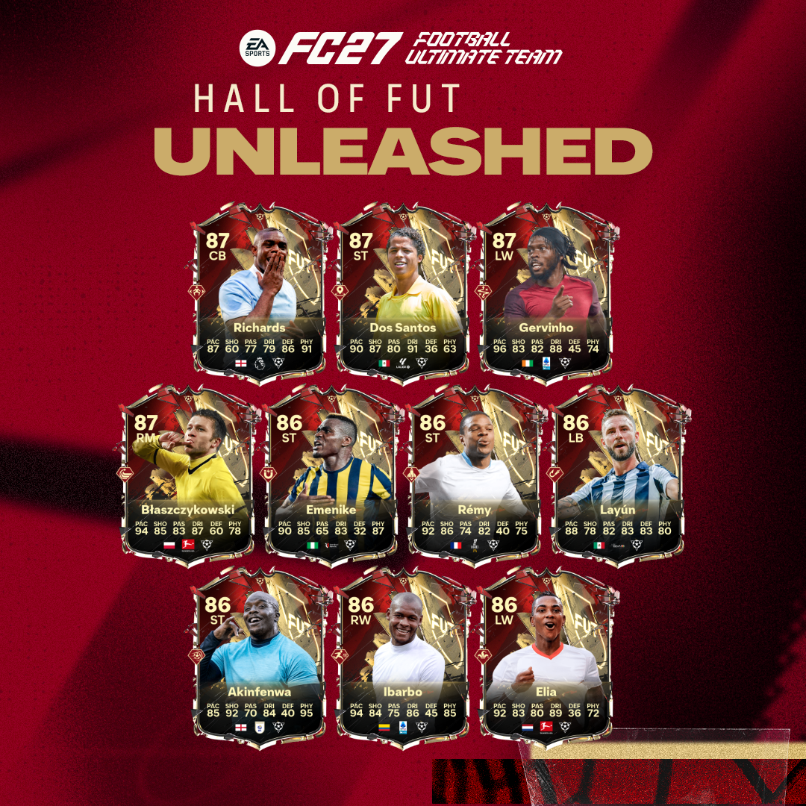

## 🎯 核心看点速览

- **活动名称**：Hall of FUT: Unleashed —— Football Ultimate Team 的情怀向大型企划，把 FUT 历史上“最让人害怕、也最让人怀念”的球员卡请回赛场。
- **核心诉求**：致敬那些定义过一个时代的传奇，让老玩家找回当年被某张卡支配（或拯救）的感觉。
- **参与方式**：属于游戏内的限时活动内容，**不是付费 DLC**，也不需要额外买季票，更新后进 FUT 模式即可参与。
- **已知边界**：官方目前放出的是活动主旨与两张主视觉，完整的卡池名单、卡面数值、进包节奏与兑换规则，仍要以游戏内公告和官方社媒为准。

## 📌 重点深度解析

### 1. “老卡回归”戳中的到底是哪批人

FUT 这十几年里出过太多“数值不讲道理、模型独一无二、手感玄学”的球员卡。它们的共同点是：不一定评分最高，但在当年那个版本里，用起来就是比同分段的卡顺手一个档次。这次 Hall of FUT: Unleashed 打的正是这张牌——把这些“时代的眼泪”重新包装成可用的现役卡，让你在当下的对局环境里再摸一次熟悉的手感。

对老玩家来说，这是一种“我当年就是靠他上分”的身份认同；对新玩家来说，这是一次补课，理解为什么某些名字在老 FUT 群体里能被念叨十年。

### 2. 为什么这个时间点推怀旧，很聪明

赛季推进到中后段，通常是玩家阵容固化、开包欲望下滑、天梯动力不足的阶段。此时丢一批“记忆点极强”的卡进来，等于用情感杠杆重新拉动参与度：

- **拉动回流**：离开一段时间的老玩家，看到熟悉的名字大概率会回来摸两把。
- **拉动开包**：情怀卡的收藏价值往往高于纯粹的强度价值，愿意为“拥有”付费的人不少。
- **拉动内容生态**：主播和内容作者天然喜欢做“XX 卡复刻对比”这类选题，传播成本极低。

### 3. 需要冷静看待的三件事

- **数值膨胀风险**：怀旧卡如果只是“换皮高分卡”，那本质还是继续推强度；真正的诚意在于还原当年的模型与手感特性，而不是简单加评分。
- **阵容背刺**：如果新卡直接压过你现有的主力位置，先别急着拆阵容——等活动规则完全公开、实测评价出来再动。
- **市场波动**：公告期到上线首日，相关同名卡、同联赛卡的价格容易剧烈波动，追高最容易吃亏。

> 主理人一句话：情怀可以买，但别在信息最不完整的那 24 小时里买。

## 💡 玩家实操与上手建议

**1）先把客户端准备好**

更新后建议先在 Steam 里做一次「验证游戏文件完整性」，尤其是跨大版本更新之后，能规避不少进模式闪退、卡面加载不出来的问题。主机玩家同理，别在活动首日顶着半个包进游戏。

**2）开包节奏这样安排**

- 活动刚开的第一天，先看官方公布的完整卡池与掉率说明，再决定要不要清空库存包。
- 手里有囤积的包，留到规则明确后再开，避免“开早了、规则变了”的尴尬。
- 微氪玩家优先考虑有保底或可兑换路径的玩法，纯赌包永远是期望值最低的选项。

**3）阵容适配别只看总评**

怀旧卡的价值通常体现在特性、模型和位置适配上。拿到卡之后先看：

- 化学连线能不能塞进你现有的联赛/国籍框架；
- 位置改造卡是否划算（有些卡换个位置就是另一个球员）；
- 体力与拼抢属性在当前版本环境里是否够用。

**4）市场操作三条纪律**

- 活动首日不追高，等第一波热度过去；
- 手里重复的、非核心阵容的高价卡，可以趁热度高位出手；
- 不要为了“凑齐一套情怀阵”清空金币，留出后续补强的弹药。

**5）开黑与联机避坑**

如果你主要玩在线对局，活动初期匹配池会明显变杂，遇到高强度阵容属于正常现象，别上头连跪。建议先在单机/低强度模式把手感和阵容磨合好，再上天梯。

游戏商店页：[EA SPORTS FC 27](https://store.steampowered.com/app/4080220/EA_SPORTS_FC_27/)

## 📢 官方 Telegram 频道推荐

想第一时间拿到这类活动的上线时间、卡池泄露、限免与史低折扣提醒？建议加入官方 Telegram 频道 **@steamhunterlink**。秒级推送，不用蹲贴吧、不用刷论坛，手机一震就知道该不该上线开包了。

## ❓ 常见问题 FAQ

**Q1：Hall of FUT: Unleashed 需要额外付费吗？是 DLC 吗？**

A：不是付费 DLC，属于游戏内的限时活动内容。只要你拥有 EA SPORTS FC 27 本体并更新到最新版本，就能进入 Football Ultimate Team 参与。具体是否需要消耗游戏内货币开包，以活动规则页为准。

**Q2：这次回归的卡，会用我当年账号里的老卡数据吗？**

A：不会。回归的是“致敬性质的新卡”，由官方重新设计与发放，与你历史账号里的旧卡无关。你的旧阵容和旧存档依然按现有规则运作，不存在自动继承或自动替换。

**Q3：活动会持续多久？卡池什么时候进包？**

A：官方目前只公布了活动主旨，具体起止时间、分批进包节奏与兑换窗口尚未完整披露。建议关注游戏内公告栏与官方社媒，或者直接蹲 **@steamhunterlink** 的推送。在规则明确前，不建议大量清空囤积的包。

**Q4：现在入坑 FUT 来得及吗？**

A：来得及，但要有心理预期——赛季中后段进场，你的阵容强度会明显落后于老玩家。好消息是情怀向活动通常会提供一些低门槛的获取路径，适合作为新手补强的起点。
