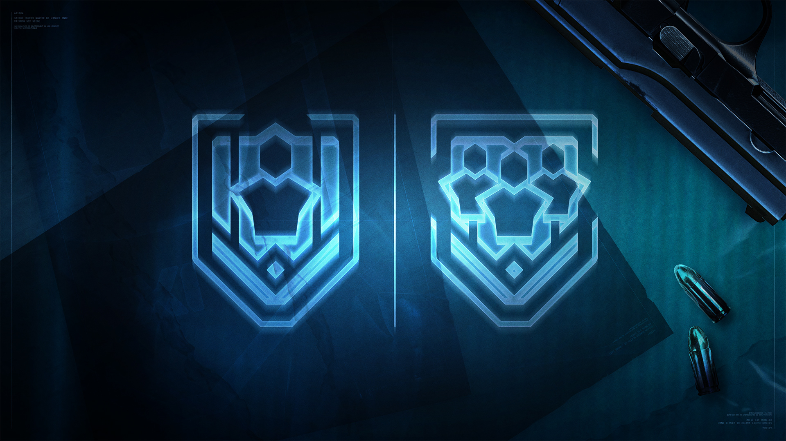
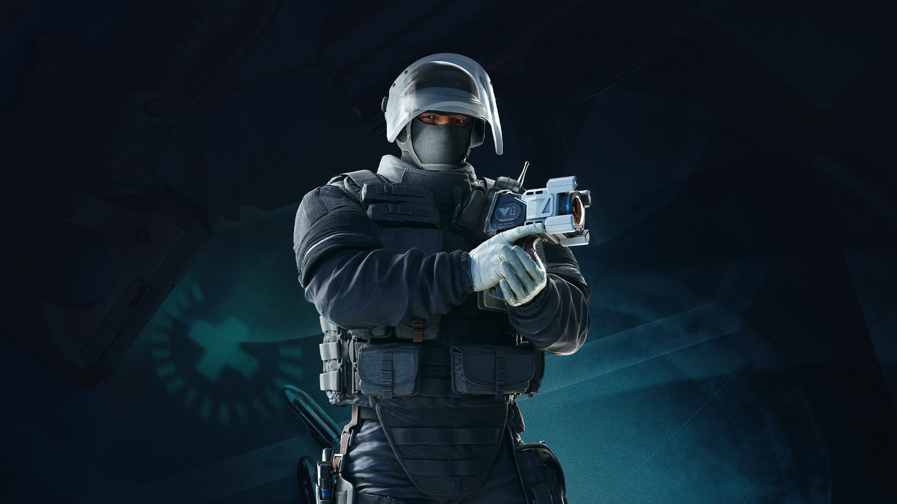
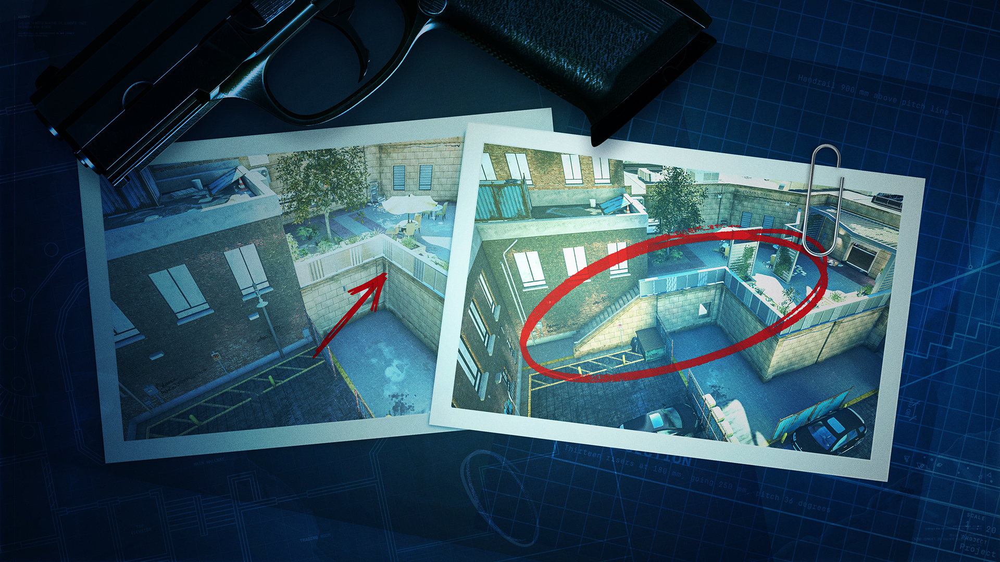
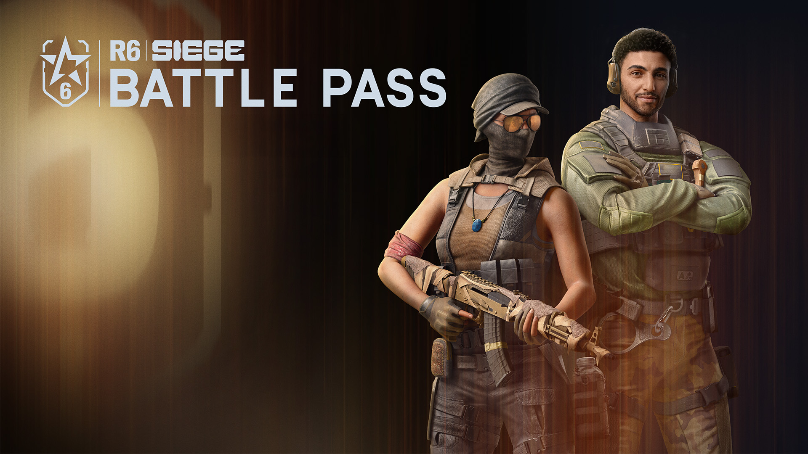

# 彩虹六号：围攻 Y11S4「关键信号」：Doc 不用再跑腿奶人了，排位也拆成了两条赛道

各位干员，把手里的无人机先停一停。育碧把 Y11S4「关键信号」行动（Operation Vital Signal）的底牌摊开了，12 月 1 日上线。这次不是那种「改了两把枪后坐力就当大版本」的操作——Doc 直接换了个职业定位，排位被劈成两条独立赛道，连银行都重新装修了一遍进攻路线。

[观看 Y11S4 行动预告片](https://rainbow6.com/y11s4_trailer_yt)

## 🎯 核心看点速览

- **上线时间**：12 月 1 日，全平台同步，Steam 端（AppID 359550）照常免费更新，不需要额外买什么。
- **Doc 重做**：新增 E-HEAL 系统，从「贴身打针的队医」升级成「远程奶人 + 远程复活」的支援核心。
- **排位分轨**：分为 Solo/Duo（单排/双排）与 Flex（灵活队列）两个独立列表，排位解锁门槛调整为 30 级。
- **新武器**：MBZ-19 进入武器库，进攻端多一个选择。
- **地图改动**：银行（Bank）迎来针对性的玩法调整，游艇（Yacht）、贫民窟（Favela）、塔楼（Tower）继续「现代化地图」计划，视觉与玩法双双翻新。
- **倒计时提醒**：当前战斗通行证即将下架，未领的奖励记得清仓，别让兜里的代币变成纪念品。

## 📌 重点深度解析

### 排位拆成两条赛道，独狼和车队各走各的门

这大概是本次最贴近日常体验的改动。以前排位里最尴尬的局面是什么？你单排进去，队友三黑四黑各聊各的，报点全靠猜，输了还得一起吃分。现在系统把 Solo/Duo 和 Flex 两个列表分开，你想要的竞技环境自己挑：想安静上分就走单双排，想和三五好友打配合就走灵活队列。

同时排位解锁门槛调整为 30 级，意味着新号不用在快速模式里熬到怀疑人生才能摸到排位按钮。对老玩家来说这不痛不痒，但对被朋友拉进坑的新干员，这波算是实打实的减负——当然，也意味着赛季初的排位池子里会混进一批还没认全地图的萌新，前两周上分请自备血压药。

### Doc 变身移动补给站，E-HEAL 让防守方多了一条命

Doc 这次被明确塑造成「真正的支援专家」。新的 E-HEAL 系统允许他远程治疗甚至远程复活队友——注意，是**跨地图**。这个改动的意义不只是「省得跑过去打针」：

- **防守方拉扯空间变大**：以前 Doc 得冒着被架枪的风险贴身救人，现在可以躲在掩体后完成支援，等于给整个防守阵型续了一层血条。
- **残局处理被重写**：1v2 变成 2v2 的翻盘窗口更多了，那些靠磨血耗死防守方的进攻套路要重新算账。
- **点位选择更灵活**：Doc 不必死守锚点，可以往后站、往侧翼站，用视野换生存，再用治疗换节奏。

代价也很明显：远程治疗意味着 Doc 需要更好的位置感与判断力，站错位置、把治疗资源交早了，你就是个没有枪械优势的普通三速干员。

### 银行开了新口子，三张老图继续现代化

银行这张图在无数场比赛里被磨成了「教科书式防守图」，这次拿到了针对性的玩法调整，官方说法是创造新的进攻机会。配上新武器 MBZ-19 的加入，进攻端的工具箱又厚了一页。同时游艇、贫民窟、塔楼继续走现代化地图的路线——贫民窟和塔楼这两张图在路人局里向来评价两极，视觉与玩法同步优化之后，至少「卡在奇怪角落看不到人」的情况会少一些。

### 战斗通行证末班车，别把奖励留到下个赛季

当前赛季的战斗通行证在 Y11S4 开启后就不再提供了。手头还压着没解锁的等级、没兑换的代币、没领完的皮肤，建议这两周集中清仓——每个赛季都有人喊着「明天再打」，然后在版本更新当天对着下架的奖励干瞪眼。

[查看战斗通行证详情](https://rainbow6.com/battlepass)

## 💡 玩家实操与上手建议

1. **更新前的准备**：12 月 1 日前把 Steam 客户端留点硬盘空间，版本更新包体向来不客气。更新完先跑一次文件完整性校验，能省掉不少「进图就崩」的玄学问题。
2. **排位分流怎么选**：有固定队就走 Flex，别在单双排里赌队友；平时只有一两个人的，Solo/Duo 列表会更接近你想要的竞技体验。新赛季头两周建议先打快速模式摸清新地图改动，再动排位分数。
3. **Doc 上手要点**：把自己当「远程医疗点」而不是「急救兵」。跟队友提前约定治疗信号的优先级，优先保住能架枪的核心位，而不是谁先喊疼就先救谁。E-HEAL 的节奏感决定你是战术核心还是团队负担。
4. **开黑避坑**：新赛季首日常见的坑是语音频道混乱与报点冲突。开局花 10 秒统一呼叫习惯，比输了之后复盘半小时管用。
5. **购买建议**：这是本体免费更新的内容，不需要额外掏钱。真正需要花钱的地方只有战斗通行证和外观。打折季看到的「本体 + DLC」捆绑包，买之前先确认含的是你确实会用的干员与皮肤，别为了凑单把仓库塞满。

## 📢 官方 Telegram 频道推荐

限免喜加一、史低背刺、版本更新公告，这类消息最怕慢半拍——等你刷到的时候，免费领取窗口已经关了。建议加入官方 Telegram 频道 **@steamhunterlink**，秒级推送限免与特惠信息，永久入库的机会一个都不放过。

## ❓ 常见问题 FAQ

**Q1：12 月 1 日的「关键信号」更新需要额外付费或购买 DLC 吗？**

不需要。这是《彩虹六号：围攻》的赛季版本更新，Steam 端（AppID 359550）玩家正常更新即可获得 Doc 重做、排位分轨、地图改动与 MBZ-19。战斗通行证与外观属于可选付费内容，不影响你体验本次核心改动。

**Q2：排位门槛改成 30 级后，我原来打过的段位会不会受影响？**

调整的是**解锁条件**，不是你的账号进度。已经能进排位的账号照常参与，新赛季开始时会按常规流程进行段位重置与定级。真正需要重新适应的是两个列表分开后的匹配环境，建议新赛季先打几把快速模式热手再进排位。

**Q3：Doc 远程治疗会不会太强，防守方以后必须带 Doc 了？**

强是强，但代价同样存在：远程治疗需要视野与位置支撑，Doc 站得靠后意味着正面火力位变薄，队伍要在「多一条命」和「多一把枪」之间做取舍。短期内 Doc 的出场率必然上涨，但能不能成为必选项，还得看上线后几周的实际数据与职业赛场的选择。
