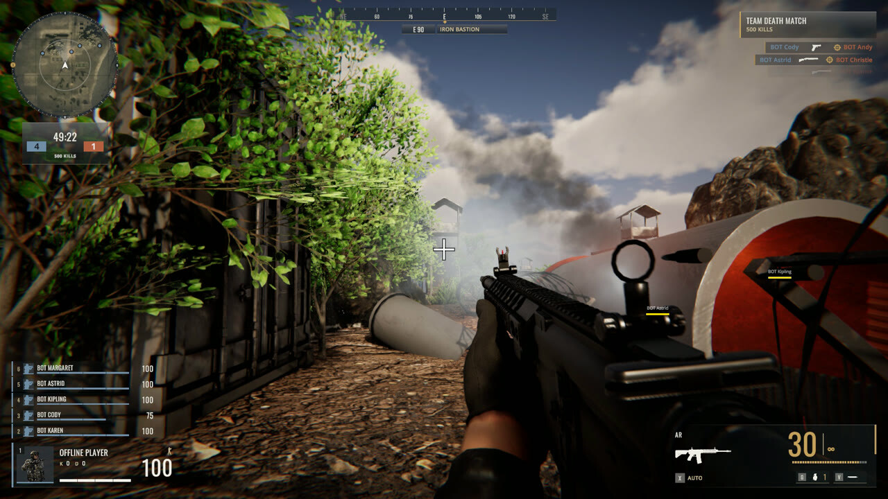
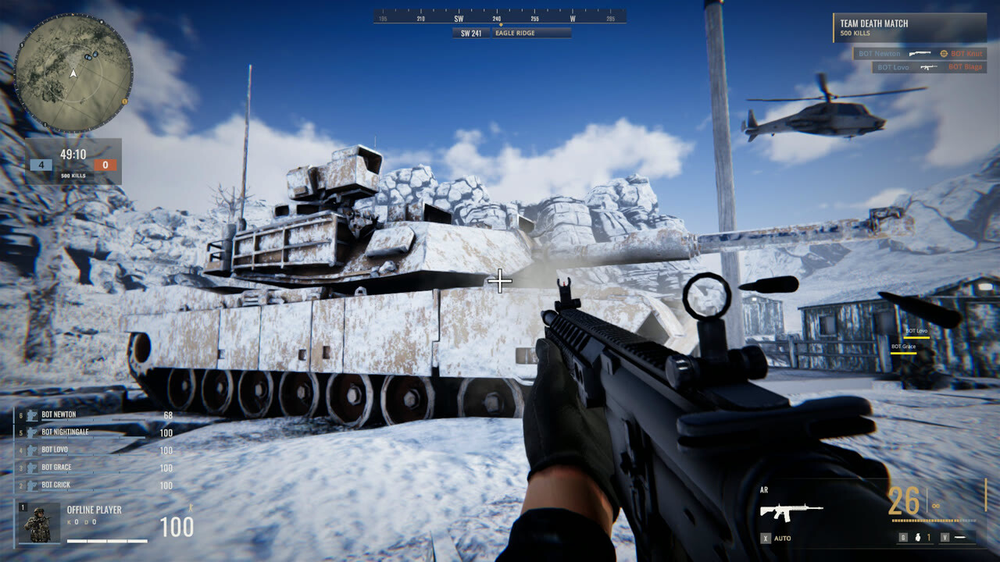
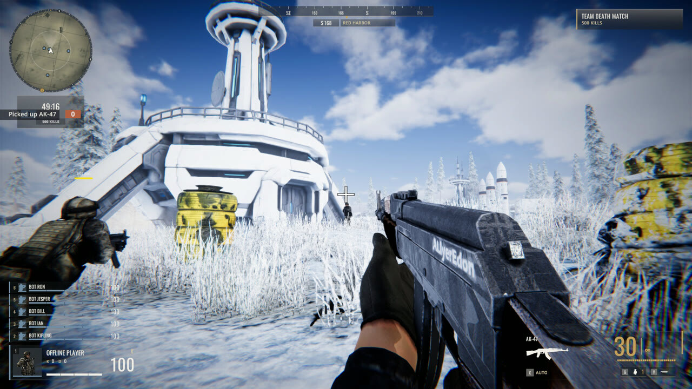
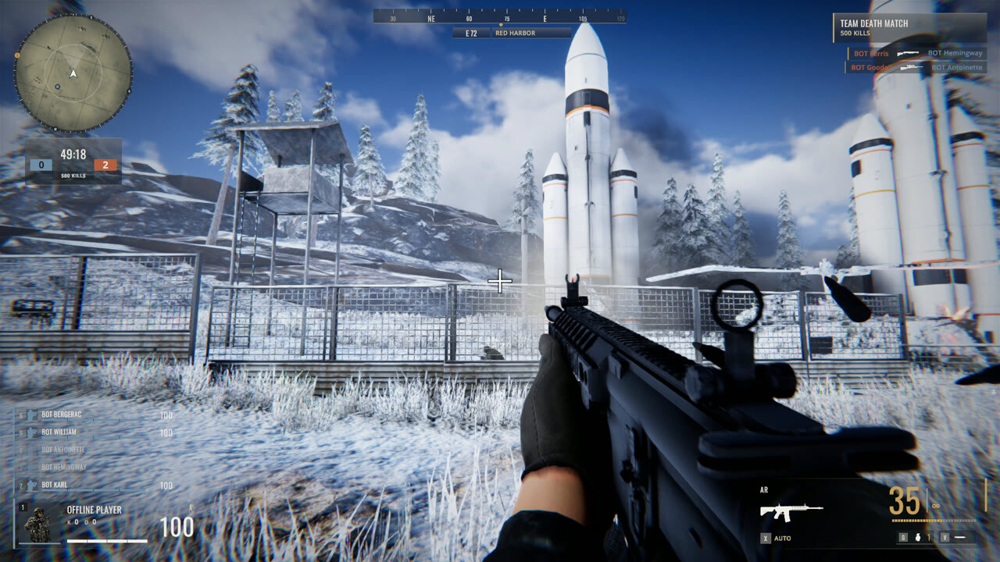

# Soldier Offensive正式版上线：抢先体验落幕，战场才刚刚开始

各位老伙计，今天这条消息对还在观望《Soldier Offensive》的朋友来说，算是个明确的信号——Casayona Studio正式宣布，游戏已经**脱离抢先体验阶段，以完整版本登陆Steam**。没有花里胡哨的发布倒计时，没有跳票声明，就是干脆利落一句：我们做完了，来打吧。

## 🎯 核心看点速览

- **状态变更**：从Early Access（抢先体验）正式转为Full Release（正式版），版本号与内容体量同步收口。
- **开发组表态**：官方在公告中重点感谢社区，称玩家反馈、Bug报告与对局参与是推动游戏成型的关键。
- **后续路线**：正式版不代表停更，Casayona Studio明确表示会继续跟进Steam社区讨论区的意见。
- **无促销信息公布**：本次公告为纯版本节点公告，未附带折扣或限免安排，想入手的玩家可先关注价格走势。

## 📌 重点深度解析

### 一、抢先体验这一程，走得算踏实

玩过EA阶段游戏的人都懂，最怕两种情况：一种是上线即巅峰、然后开发组人间蒸发；另一种是永远在“即将正式版”的路上反复横跳。《Soldier Offensive》这次给出的答案是——按节点收尾，正式版落地。

从公告措辞能读出一点东西：官方特别强调了“每一条提交的报告、每一个分享的建议、每一小时待在战场上的时间”都帮助游戏变得更好。这话不算新鲜，但结合EA期实际更新节奏来看，至少说明开发组确实把社区反馈当成了迭代输入，而不是发完公告就关评论。

### 二、正式版意味着什么

对射击类游戏来说，“正式版”通常对应三件事：

1. **内容框架定型**：核心玩法模式、地图池、武器与兵种体系基本不会再推倒重来，后续以增补和平衡性调整为主。
2. **存档与进度更稳**：EA期常见的“更新一次清一次档”风险显著降低，长期投入的时间更保值。
3. **评价体系重算起点**：Steam页面的正式版标签会吸引一批此前因EA状态犹豫的玩家入场，联机匹配池有望迎来一波新鲜血液。

### 三、社区反馈仍是主线

公告里专门留了一段“Stay Connected”，明确让玩家继续通过Steam社区讨论区提意见。对一款主打对战的射击游戏而言，这意味着**平衡性调整与BUG修复还会持续滚动**。老玩家可以继续盯更新日志，新玩家也别指望首发即完美——正式版是里程碑，不是终点线。

## 💡 玩家实操与上手建议

**想入手的朋友：**

- 先看Steam商店页的近期评价与总体评价走势，重点翻一翻正式版发布之后的评论，这比EA期的老评价更有参考价值。
- 关注是否搭配首发折扣。正式版上线窗口期常有“转正特惠”，不急的话可以等一手。
- 确认是否有本体与DLC的打包方案，射击游戏常见的皮肤包、季票类内容，单买往往不如捆绑划算。

**准备联机的朋友：**

- 优先约熟人开黑。正式版初期会涌入大量新玩家，路人局磨合成本高，语音沟通能显著提升体验。
- 注意服务器区域选择，跨区匹配容易吃到高延迟，射击游戏里几十毫秒的差距就是先开枪后倒下的区别。
- 遇到卡顿先排查本地：关闭后台占用带宽的程序，显卡驱动更新到位，画质预设先往中低档压一档跑稳帧率，再逐步上调。

**已经在战场上的老兵：**

- 正式版后建议重新过一遍键位与设置，版本收口阶段常伴随默认参数调整。
- 把体验问题通过Steam社区讨论区反馈，官方已明确会持续跟进，这是最直接的沟通渠道。

## 📢 官方 Telegram 频道推荐

想第一时间抓到限免、史低和转正特惠，建议加入 Telegram 频道 **@steamhunterlink**。这类正式版上线节点往往伴随短期促销，秒级推送能帮你避开“刚买完就打折”的尴尬。频道同步推送免费周末、喜加一永久入库等信息，蹲折扣的效率比手动刷商店页高得多。

## ❓ 常见问题 FAQ

**Q1：正式版上线后，抢先体验期的存档和进度还在吗？**

A：官方本次公告未提及清档安排，按常规情况，EA转正式版会尽量保留玩家进度。稳妥起见，建议进游戏前先确认本地存档位置并做一次备份，尤其是投入时间较长的账号。

**Q2：现在买和等打折买，哪个更合适？**

A：本次公告是版本节点公告，没有附带折扣信息。如果你对这类战术射击玩法兴趣明确、且身边有固定开黑队友，现在入手可以直接吃到正式版匹配池扩张的红利；如果只是观望尝鲜，建议加入 @steamhunterlink 蹲一波转正促销再动手。

**Q3：正式版之后还会更新吗？会不会做完就跑？**

A：Casayona Studio在公告中明确表示会继续密切关注玩家反馈，并引导玩家通过Steam社区讨论区提交意见。从表态看，后续的平衡性调整与问题修复仍在计划内。当然，具体更新频率与内容规模还要以官方后续公告为准。
