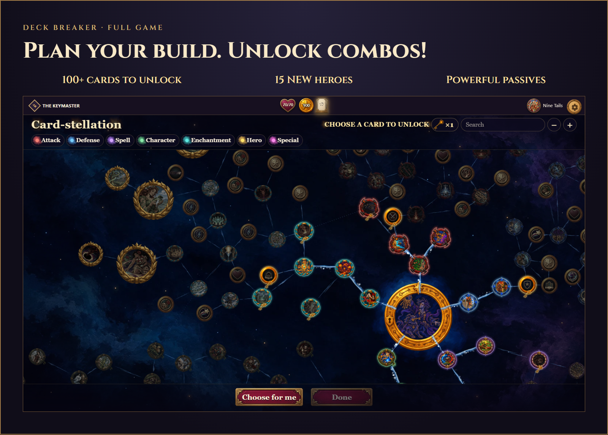
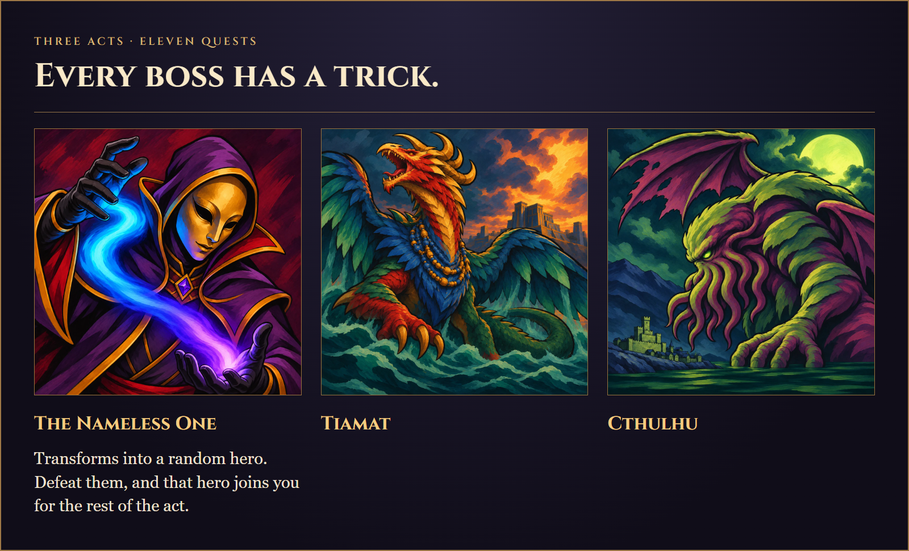
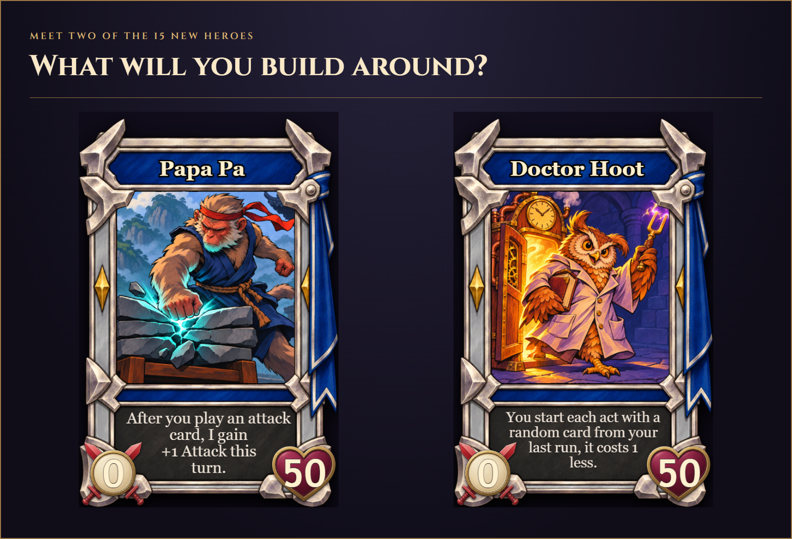
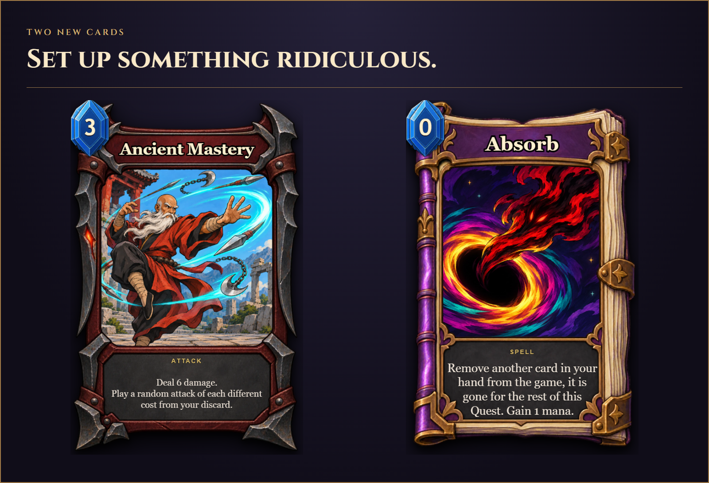
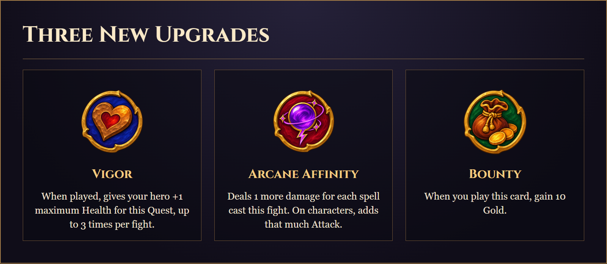

我先给结论：这次不是小打小闹的补丁，而是把《Deck Breaker》的骨架直接加粗了一圈。卡牌星图、15 位新英雄、三幕 11 任务，再加上一堆新面孔和新升级，构筑党与开荒党都有得忙了。

## 🎯 核心看点速览

- Card-stellation 星图上线：100+ 卡牌、15 位新英雄、强力被动都被串进可探索、可规划的解锁路径。
- 完整冒险扩至三幕：Act 1 有 3 个 Quest，Act 2 有 4 个，Act 3 有 4 个，合计 11 个任务。
- Boss 不再只是数值墙：每个 Boss 都有独立机制，The Nameless One 会变身成随机英雄，打赢后该英雄还会加入你当前幕的后续旅程。
- 新角色 Papa Pa 与 Doctor Hoot 登场，Ancient Mastery 与 Absorb 新关键词/机制亮相，另有三项新升级加入构筑池。
- 对 Roguelike 卡牌构筑玩家来说，这波重点不是“多几张卡”，而是路线规划、组合预判与 Boss 应对深度一起抬高。

## 📌 重点深度解析

### 1. Card-stellation：把解锁做成一张可规划的星图

这次最值得研究的就是 Card-stellation。它把 100+ 卡牌、15 位新英雄和强力被动放进一张可探索的路径网里，你可以先看准想玩的 combo，再沿着星图朝目标推进。换句话说，开荒不再是纯看脸抽卡，而是多了“我先定流派，再拿组件”的运营感。

对构筑玩家来说，这种设计很容易上头：你先瞄上一个被动或英雄，再倒推需要哪些卡牌，最后在局内围绕这条路线补强。15 位新英雄也意味着组合空间被明显拉宽，别一上来就按旧套路硬凹，先看星图给什么，再决定这局走爆发、续航还是资源循环。

### 2. 三幕 11 任务，Boss 机制才是重头戏

完整冒险现在跨三幕、共 11 个 Quest。Act 1 三个任务负责铺路，Act 2 四个任务加码，Act 3 再用四个任务收束。真正有记忆点的是 Boss 机制：每个 Boss 都有独立玩法，不是单纯把血量往上堆。

The Nameless One 的设计尤其有梗：它会变成随机英雄让你先打一场，击败后该英雄会加入你当前幕的剩余流程。翻译成玩家话就是“打不过就加入”，但顺序得反过来——你得先赢，它才入队。这种机制会逼你临场读特性、调卡组，而不是一套卡从第一幕凹到最后一幕。

### 3. 新面孔、新关键词、新升级

Papa Pa 和 Doctor Hoot 这两位新角色登场，具体交互与定位建议进游戏后结合事件文本体验。Ancient Mastery 与 Absorb 也作为新机制亮相，从命名看就是围绕“积累”和“吸收”做文章，实际数值与触发条件以游戏内说明为准。

另外还有三项新升级加入。我的建议是别看到升级就无脑抓，先看它能不能补你当前卡组的短板：缺过牌就补循环，缺终端就补伤害，缺容错就拿防御或资源类升级。Roguelike 卡牌最怕“什么都想要”，最后卡组曲线四不像。

## 💡 玩家实操与上手建议

- 先规划再开点：进 Card-stellation 后别急着乱铺路，先锁定一个想玩的 combo，再朝对应卡牌、英雄和被动推进。
- Boss 前留针对位：三幕 Boss 机制差异明显，尤其是会变身英雄的 The Nameless One，别把关键解场或爆发全交在前面的小怪身上。
- 新升级看曲线：三项新升级不是必拿，先判断卡组是缺资源、缺终端还是缺防御，再决定抓位。
- 更新后先校验文件：Steam 库中右键游戏检查完整性，避免旧缓存导致新内容显示异常；有云存档就先确认同步状态，再开新档。
- 购买与入库建议：先看商店页当前版本、本体与组合包内容，已拥有本体就别重复买包；愿望单先加好，等折扣或正式版信息明确再下手。
- 开荒别怕换流派：15 位新英雄和 100+ 卡牌摆在这，前期多试几条星图路线，比死磕一套旧卡组更容易找到版本答案。

## 📢 官方 Telegram 频道推荐

想第一时间蹲 Steam 秒级限免、临时工价和特惠背刺，我会把提醒同步到官方 Telegram 频道 @steamhunterlink。先把频道加进收藏，别等史低结束了才拍大腿；喜加一和永久入库这种好事，手慢真的会没。

## ❓ 常见问题 FAQ

**Q1：Card-stellation 是随机解锁，还是可以规划路线？**

A：从目前信息看，它更偏向可探索、可规划的路径解锁：100+ 卡牌、15 位新英雄和强力被动都挂在星图上，你可以先定目标 combo 再朝对应节点推进。具体节点消耗、重置规则以游戏内说明为准。

**Q2：三幕 11 个任务会不会流程偏短？**

A：任务数量是 Act 1 三个、Act 2 四个、Act 3 四个，但每个 Boss 都有独立机制，实际时长还取决于你的构筑熟练度、探索路线和重开次数。别只看任务数，Boss 机制和星图解锁会把开荒时间拉长。

**Q3：The Nameless One 打不过怎么办？**

A：它会变身成随机英雄，你需要先击败对方，胜利后该英雄才会加入当前幕的剩余流程。建议根据变身英雄的特性临时调整卡组，别一套卡硬凹；如果实战提示与预期不符，优先看游戏内机制说明和卡牌描述。
